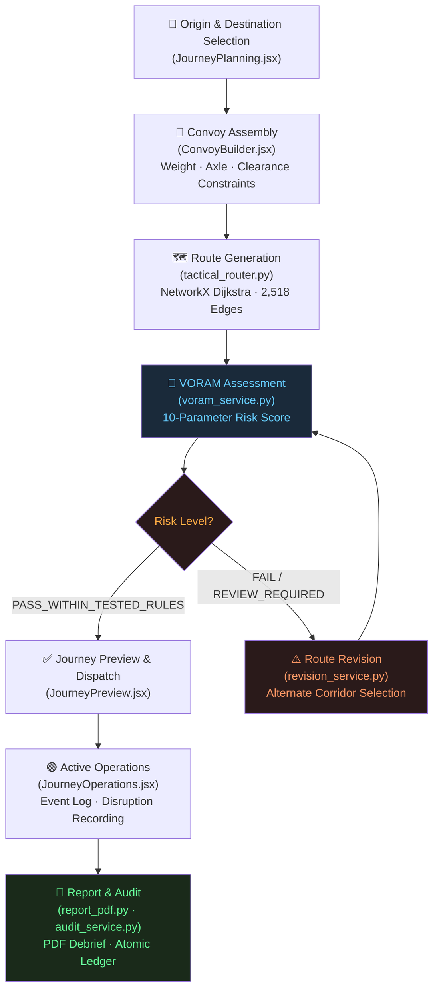
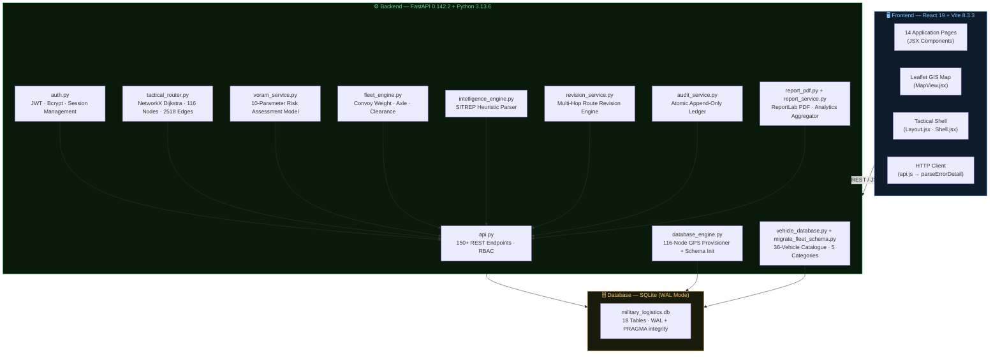

<div align="center">


# VAYU ORBIT

### Intelligent Convoy Movement Planning & Dynamic Route Optimisation System
**Military Logistics Decision Support · Academic Prototype v6.0.0**

---

[](https://python.org)
[](https://fastapi.tiangolo.com)
[](https://react.dev)
[](https://vitejs.dev)
[](https://sqlite.org)
[](https://networkx.org)
[](AUTHORIZED_USE.md)
[]()
[]()

---

> **⚠️ Academic Prototype Disclaimer**
> VAYU ORBIT is an academic decision-support simulation prototype developed at Lovely Professional University.
> It is **not** operationally deployed by any armed force, government body, or defence organisation.
> No classified data, real-time military intelligence, or certified safety systems are used.
> All route networks, telemetry, and SITREP feeds are simulated approximations for academic evaluation.

---

*Intelligence Around Every Journey*

</div>

---

## 📋 Table of Contents

- [Project Overview](#-project-overview)
- [Key Capabilities](#-key-capabilities)
- [How It Works — Journey Lifecycle](#-how-it-works--journey-lifecycle)
- [System Architecture](#-system-architecture)
- [Technology Stack](#-technology-stack)
- [VORAM — Route Assessment Model](#-voram--route-assessment-model)
- [Interface Showcase](#-interface-showcase)
- [Installation & Setup](#-installation--setup)
- [Running the Application](#-running-the-application)
- [Project Structure](#-project-structure)
- [API Overview](#-api-overview)
- [Fleet Catalogue](#-fleet-catalogue)
- [Database Schema](#-database-schema)
- [Demo Scenarios](#-demo-scenarios)
- [Security & Limitations](#-security--limitations)
- [Roadmap](#-roadmap)
- [Contributors](#-contributors)
- [Licence & Authorised Use](#-licence--authorised-use)

---

## 🎯 Project Overview

Modern military convoy planning operates within a dense web of competing constraints — vehicle payload limits, bridge load ceilings, road geometry, fuel feasibility, weather disruptions, and real-time incident events. Coordinating this manually introduces compounding risk and coordination overhead.

**VAYU ORBIT** is a full-stack academic prototype that consolidates convoy movement planning, constraint-aware route optimisation, operational journey management, and mission debriefing into a single unified decision-support platform.

The system is built on a **116-node military corridor network** spanning major Indian military installations, computed using **Dijkstra shortest-path routing** on a **NetworkX graph with Haversine-distance weighted edges**. Every planned journey passes through the **VORAM risk assessment engine**, a deterministic multi-parameter scoring model, before dispatch approval.

| Dimension | Detail |
|---|---|
| **Nodes (Installations)** | 116 military installations with GPS coordinates |
| **Corridor Edges** | 2,518 weighted graph edges |
| **Vehicle Catalogue** | 36 vehicle models across 5 tactical categories |
| **API Endpoints** | 150+ REST endpoints |
| **Role-Based Access** | 3 operational roles with distinct permissions |
| **Backend Tests** | 57 automated pytest cases, all passing |
| **Frontend Views** | 14 active application pages |

---

## ⚡ Key Capabilities

| # | Capability | Status |
|---|---|---|
| 1 | **Journey Planning** — Origin/destination selection with session-draft persistence | ✅ Implemented |
| 2 | **Convoy Builder** — Vehicle selection, weight/axle/clearance constraint derivation | ✅ Implemented |
| 3 | **NetworkX Dijkstra Routing** — Multi-route alternative generation on 116-node corridor graph | ✅ Implemented |
| 4 | **VORAM Assessment** — 10-parameter deterministic route risk scoring with safeguard rules | ✅ Implemented |
| 5 | **Fuel Feasibility Analysis** — Range calculations against vehicle fuel capacity and route distance | ✅ Implemented |
| 6 | **Journey Operations** — Live lifecycle management with atomic disruption logging | ✅ Implemented |
| 7 | **SITREP Heuristic Parser** — Free-text situational report processing to structured threat data | ✅ Implemented |
| 8 | **Disruption-Aware Route Revision** — Multi-hop revision engine with rererouting on active incidents | ✅ Implemented |
| 9 | **Fleet Management** — 36-vehicle master catalogue with operational status tracking | ✅ Implemented |
| 10 | **Audit Ledger** — Atomic, append-only operational audit trail for all system events | ✅ Implemented |
| 11 | **PDF Debrief Reports** — ReportLab-generated journey debrief documents | ✅ Implemented |
| 12 | **Role-Based Access Control** — JWT + bcrypt auth with 3 roles and permission enforcement | ✅ Implemented |
| 13 | **Analytics Dashboard** — Aggregated KPI metrics across historical journey records | ✅ Implemented |
| 14 | **GIS Map Visualisation** — Leaflet-based interactive tactical map with route overlays | ✅ Implemented |
| 15 | **Scenario Lab** — What-if perturbation engine for experimental route stress testing | 🔬 Experimental |
| 16 | **Elevation Profile** — Route gradient visualisation component | 🔬 Experimental |

> **Legend:** ✅ Fully Implemented · 🔬 Experimental / Partially Implemented · 📋 Planned

---

## 🔄 How It Works — Journey Lifecycle

The VAYU ORBIT operational lifecycle follows a structured six-phase loop:


### Journey Phase Detail



---

## 🏗️ System Architecture



---

## 🛠️ Technology Stack

### Backend

[](https://python.org)
[](https://fastapi.tiangolo.com)
[](https://uvicorn.org)
[](https://docs.pydantic.dev)
[](https://networkx.org)
[](https://pandas.pydata.org)
[](https://pyjwt.readthedocs.io)
[](https://pypi.org/project/bcrypt/)
[](https://reportlab.com)
[](https://python-pillow.org)
[](https://sqlite.org)

### Frontend

[](https://react.dev)
[](https://vitejs.dev)
[](https://leafletjs.com)
[](https://lucide.dev)

### Fonts (Google Fonts via CDN)
- **Orbitron** — Primary tactical heading typeface
- **Share Tech Mono** — Monospaced data display
- **Inter** — Body text and labels

---

## 🔬 VORAM — Route Assessment Model

**VORAM (VAYU ORBIT Risk Assessment Model) v0.1** is a deterministic, multi-parameter route evaluation engine. It is **not** a trained machine-learning model. It applies a weighted scoring matrix across **10 operational parameters**, enforces a maximum-component safeguard rule, tracks evidence provenance and data freshness, and integrates with the tactical corridor graph.

<details>
<summary><strong>📊 10-Parameter Assessment Matrix (click to expand)</strong></summary>

| Parameter | Weight | Assessment Domain |
|---|---|---|
| **Road Condition** | 15% | Surface degradation, pavement distress, unpaved sectors, carriageway defects |
| **Bridge & Load Compatibility** | 15% | Bridge classification, culvert load ceilings, gross vehicle weight safety margins |
| **Road Closure & Access Restrictions** | 12% | Confirmed physical closures, military access checkpoints, curfew orders, route blockades |
| **Flooding & Waterlogging** | 12% | Monsoon inundation, riverine spillage, low-lying water accumulation, ford impassability |
| **Weather Impact** | 10% | Precipitation intensity, visibility reduction (dense fog/dust), high crosswinds, thermal strain |
| **Terrain & Gradient** | 8% | Incline steepness, switchback frequency, mountain-pass friction, soil stability |
| **Road Width & Clearance** | 8% | Carriageway width, vertical overhead clearance (underpasses/cables), tight corner radius |
| **Logistics Support Availability** | 8% | Proximity to supply depots, recovery workshops, refuelling stations, medical outposts |
| **Traffic Congestion** | 7% | Civilian traffic density, urban transit friction, commercial choke points |
| **Travel-Time Variability** | 5% | Transit time predictability, checkpoint hold times, corridor delay dispersion |
| | **Σ 100%** | |

</details>

<details>
<summary><strong>⚙️ Scoring Methodology (click to expand)</strong></summary>

The VORAM composite score is calculated as:

$$\text{Composite Score} = \sum_{i=1}^{10} \left( w_i \times s_i \right) \div 100$$

Where $w_i$ is the parameter weight (%) and $s_i$ is the operator-supplied parameter score (0–100).

**Safeguard Rule:** The final approved score is bounded by:

$$\text{Final Score} = \min\left(\text{Composite Score},\ k \times \max(s_i)\right)$$

Where $k$ is the safeguard coefficient (default: **0.80**). This prevents an artificially high composite from masking a critically low individual parameter score.

**Assessment Outcomes:**

| Outcome | Meaning |
|---|---|
| `PASS_WITHIN_TESTED_RULES` | Composite score meets threshold; all mandatory constraints satisfied |
| `FAIL` | Score below pass threshold or mandatory constraint violated |
| `REVIEW_REQUIRED` | Evidence gaps, staleness, or conflicting data detected |
| `UNKNOWN` | Insufficient input data to compute a valid score |
| `MODEL_ERROR` | Internal validation or computation failure |

**Risk Categories:** `Low Concern` · `Moderate Concern` · `High Concern` · `Critical Concern`

**Evidence States:** `VERIFIED` · `UNVERIFIED` · `STALE` · `MISSING` · `CONFLICTING` · `DERIVED`

> ⚠️ **VORAM Disclaimer:** VORAM v0.1 weights and thresholds have **not** been empirically validated on live military operational theatre telemetry. A PASS status does **not** constitute a safety certificate.

</details>

---

## 🖥️ Interface Showcase

The following showcase images are captured from the live prototype application.

### Journey Planning


### Route Intelligence & Assessment


### Active Journey Operations


<details>
<summary><strong>📸 Additional Interface Screenshots</strong></summary>

| View | Screenshot |
|---|---|
| Route Planning (raw) |  |
| Route Intelligence (raw) |  |
| Convoy Builder |  |
| Operations (raw) |  |

</details>

> **Note on additional screenshots:** The following views do not yet have screenshots committed to the repository. If you wish to document them, capture them from a running instance and place them in `assets/screenshots/`:
> - `overview_dashboard.png` — Mission control dashboard
> - `fleet_management.png` — 36-vehicle master catalogue
> - `analytics_dashboard.png` — KPI metrics view
> - `journey_history.png` — Historical journey log
> - `voram_panel.png` — VORAM assessment breakdown panel
> - `sitrep_parser.png` — SITREP heuristic parser interface
> - `pdf_report.png` — Generated PDF debrief sample

---

## 🚀 Installation & Setup

### Prerequisites

| Requirement | Minimum Version |
|---|---|
| Python | 3.11+ (tested on 3.13.6) |
| Node.js + npm | 18+ (tested on npm 11.x) |
| Git | Any recent version |
| Operating System | Windows 10/11, Linux, macOS |

---

### 1. Clone the Repository

```bash
git clone <repository-url>
cd programme
```

### 2. Install Backend Dependencies

```bash
pip install -r backend/requirements.txt
```

> **Note:** All packages install at user level. No virtual environment is required, though one is recommended for isolation.

<details>
<summary><strong>📦 Core Backend Packages</strong></summary>

```
fastapi          — REST API framework
uvicorn          — ASGI server
pydantic         — Data validation
networkx         — Graph routing engine
pandas           — Data processing
ortools          — Combinatorial optimisation (installed)
PyJWT            — JSON Web Token authentication
passlib          — Password hashing framework
bcrypt           — Salted bcrypt hashing
reportlab==4.4.10 — PDF report generation
pillow==11.3.0   — Image processing
```

</details>

### 3. Install Frontend Dependencies

```bash
npm --prefix frontend install
```

### 4. Initialise the Demo Database

```bash
python backend/prepare_demo_db.py
```

This resets the demo database with integrity verification. The master catalogue database (`backend/military_logistics.db`) must be present (included in the repository).

### 5. Seed Demo Scenarios *(Optional)*

```bash
python backend/seed_demo_scenarios.py
```

Pre-stages three guided demonstration journeys with realistic events and convoy configurations.

---

## ▶️ Running the Application

### Option A — Integrated Demo Launcher *(Recommended)*

```bash
python backend/demo_launcher.py
```

The demo launcher:
- Verifies database SHA-256 integrity before startup
- Starts the FastAPI backend on `http://localhost:8000`
- Starts the Vite frontend development server on `http://localhost:5173`
- Supervises both processes as a unified session

### Option B — Manual Startup

**Backend (Terminal 1):**
```bash
uvicorn backend.api:app --reload --host 0.0.0.0 --port 8000
```

**Frontend (Terminal 2):**
```bash
npm --prefix frontend run dev
```

Then open your browser at: **http://localhost:5173**

### Option C — Frontend Production Build

```bash
npm --prefix frontend run build
```

Outputs optimised static assets to `frontend/dist/`.

---

### Demo Access Credentials

> ⚠️ **For demonstration and academic evaluation only.** Do not use these credentials in any real-world or production deployment.

| Role | Description |
|---|---|
| **COORDINATOR** | Full system access — journey creation, approval, operations management, reporting |
| **CREATOR** | Journey planning and convoy assembly |
| **CHECKPOINT_OPERATOR** | Journey event logging and status updates |

> Refer to `academic/VAYU_ORBIT_ACADEMIC_RELEASE/documentation/DEMO_QUICK_START.md` for the complete setup and login walkthrough.

---

### Running the Test Suite

```bash
python -m pytest backend/tests -v
```

**Expected result:** 57 tests passing, 0 failures.

---

## 📂 Project Structure

<details>
<summary><strong>📁 Full Directory Tree (click to expand)</strong></summary>

```text
programme/
│
├── backend/
│   ├── api.py                      ← FastAPI application (150+ endpoints, RBAC)
│   ├── auth.py                     ← JWT + bcrypt authentication
│   ├── audit_service.py            ← Atomic append-only audit ledger
│   ├── database_engine.py          ← 116-node GPS provisioner + schema init
│   ├── fleet_engine.py             ← Convoy weight / axle / clearance engine
│   ├── intelligence_engine.py      ← Heuristic SITREP text parser
│   ├── tactical_router.py          ← NetworkX Dijkstra corridor router
│   ├── voram_service.py            ← VORAM 10-parameter risk assessment
│   ├── vehicle_database.py         ← Fleet provisioner
│   ├── migrate_fleet_schema.py     ← 36-vehicle catalogue with detailed specs
│   ├── revision_service.py         ← Multi-hop route revision engine
│   ├── report_service.py           ← Journey analytics aggregator
│   ├── report_pdf.py               ← ReportLab PDF debrief generator
│   ├── scenario_engine.py          ← What-if perturbation engine (experimental)
│   ├── demo_launcher.py            ← Process supervisor with integrity guards
│   ├── prepare_demo_db.py          ← Demo database reset + verification
│   ├── seed_demo_scenarios.py      ← Demo journey pre-staging
│   ├── military_logistics.db       ← Master SQLite database (WAL mode)
│   ├── requirements.txt
│   ├── tests/                      ← 57 automated pytest cases
│   └── archive/
│       ├── code_backups/           ← Versioned .bak source checkpoints
│       └── database_backups/       ← Historical database snapshots
│
├── frontend/
│   ├── src/
│   │   ├── pages/                  ← 14 application page components (JSX)
│   │   │   ├── Login.jsx
│   │   │   ├── Overview.jsx
│   │   │   ├── JourneyPlanning.jsx
│   │   │   ├── ConvoyBuilder.jsx
│   │   │   ├── RouteAssessment.jsx
│   │   │   ├── JourneyPreview.jsx
│   │   │   ├── JourneyOperations.jsx
│   │   │   ├── JourneyHistory.jsx
│   │   │   ├── FleetManagement.jsx
│   │   │   ├── PlaceManagement.jsx
│   │   │   ├── Analytics.jsx
│   │   │   ├── JourneyReport.jsx
│   │   │   ├── ProfileSettings.jsx
│   │   │   └── AboutCMS.jsx
│   │   ├── components/
│   │   │   ├── Layout.jsx          ← Tactical shell · header · sidebar · IST clock
│   │   │   ├── MapView.jsx         ← Leaflet GIS map (37KB)
│   │   │   ├── Shell.jsx
│   │   │   ├── ErrorBoundary.jsx
│   │   │   ├── navigation/
│   │   │   │   └── RouteDirectionsPanel.jsx
│   │   │   └── planning/           ← DepartureScheduler · ElevationProfile ·
│   │   │                              EndpointSelector · JourneyReadinessSummary ·
│   │   │                              PlanningForm · PlanningMap · RopReportModal ·
│   │   │                              RoutePreview · SensitivityAdvisoryCard ·
│   │   │                              StepProgress · VoramAssessmentPanel · useRoute
│   │   ├── services/
│   │   │   ├── api.js              ← Centralised HTTP client
│   │   │   ├── journeySelection.js
│   │   │   ├── navigationService.js
│   │   │   └── preferences.js
│   │   ├── App.jsx
│   │   ├── main.jsx
│   │   └── styles.css              ← Tactical design system tokens
│   ├── public/
│   │   ├── vayu_logo.png           ← Brand logo (95KB)
│   │   ├── vayu_symbol.png         ← Brand symbol (12KB)
│   │   ├── showcase/               ← Interface showcase images (9 files)
│   │   └── vehicles/               ← 36 vehicle SVG + PNG assets (72 files)
│   ├── index.html                  ← HTML5 root (Orbitron · Share Tech Mono · Inter)
│   ├── package.json                ← Frontend manifest v6.0.0
│   └── vite.config.js
│
├── academic/
│   └── VAYU_ORBIT_ACADEMIC_RELEASE/  ← Self-contained academic distribution (170 files)
│       ├── LICENSE · COPYRIGHT.md · AUTHORIZED_USE.md
│       ├── THIRD_PARTY_NOTICES.md · README.md
│       ├── backend/  frontend/  documentation/
│
├── _quarantine_20261103_224628/     ← Stage 2 cleanup quarantine archive
├── VAYU_ORBIT_AGENT_HANDOVER.md
├── CLEANUP_EXECUTION_LOG.md
├── ACADEMIC_RELEASE_BUILD_REPORT.md
└── README.md                        ← This file
```

</details>

---

## 🔌 API Overview

The FastAPI backend exposes **150+ REST endpoints** at `http://localhost:8000`. Interactive API documentation is auto-generated at:

- **Swagger UI:** `http://localhost:8000/docs`
- **ReDoc:** `http://localhost:8000/redoc`

<details>
<summary><strong>📡 API Endpoint Groups (click to expand)</strong></summary>

| Group | Base Path | Description |
|---|---|---|
| Authentication | `/auth/*` | Login, logout, token refresh, user session management |
| Journey Planning | `/journey/*` | Create, draft, commit, list, retrieve journeys |
| Route Computation | `/route/*` | Dijkstra route generation, alternative corridors |
| VORAM Assessment | `/voram/*` | Risk assessment computation and storage |
| Convoy Builder | `/convoy/*` | Vehicle selection, constraint derivation |
| Fleet Management | `/fleet/*` | Vehicle catalogue, status updates |
| Place Management | `/places/*` | Military installation registry |
| Journey Operations | `/operations/*` | Journey lifecycle events, disruption logging |
| Route Revision | `/revision/*` | Active route revision on disruption |
| SITREP Processing | `/sitrep/*` | Heuristic SITREP text parsing |
| Fuel Feasibility | `/fuel/*` | Range and feasibility checks |
| Analytics | `/analytics/*` | Aggregated KPI and journey metrics |
| Reports | `/report/*` | Journey analytics and PDF debrief generation |
| Audit Log | `/audit/*` | Append-only operational event ledger |
| Users | `/users/*` | User management, role assignment |

</details>

---

## 🚗 Fleet Catalogue

VAYU ORBIT manages a **36-vehicle master catalogue** across **5 tactical categories**, each with detailed operational specifications including payload capacity, gross vehicle weight, axle configuration, fuel capacity, and road clearance.

<details>
<summary><strong>🔧 Vehicle Categories (click to expand)</strong></summary>

| Category | Code | Description |
|---|---|---|
| **Light Tactical Vehicle** | LTV | Reconnaissance, command, and liaison vehicles |
| **Medium Support Vehicle** | MSV | General cargo and troop transport |
| **Heavy Support Vehicle** | HSV | High-payload bulk logistics and equipment transport |
| **Armoured Combat Vehicle** | ACV | Armoured troop carriers and protected mobility |
| **Heavy Equipment Transporter** | HET | Tank and heavy-plant recovery and transport |

> Vehicle SVG and PNG assets for all 36 models are available in `frontend/public/vehicles/` (72 files total).

</details>

---

## 🗄️ Database Schema

The master SQLite database (`backend/military_logistics.db`) operates in **WAL (Write-Ahead Logging) mode** with PRAGMA integrity enforcement. It contains **18 tables**:

<details>
<summary><strong>📊 Table Overview (click to expand)</strong></summary>

| Table | Purpose |
|---|---|
| `military_nodes` | 116 military installation GPS coordinates and metadata |
| `vehicle_master` | 36 vehicle model specifications |
| `places` | Military installation operational registry |
| `journeys` | Journey records with lifecycle state |
| `journey_events` | Atomic event log per journey |
| `audit_log` | System-wide append-only audit ledger |
| `vehicle_status` | Per-vehicle operational status |
| `fleet_units` | Convoy fleet unit assignments |
| `users` | User accounts and RBAC roles |
| `incidents` | Recorded disruption and incident events |
| `journey_spacing_config` | Inter-vehicle spacing rules per journey |
| `journey_fuel_config` | Fuel feasibility configuration |
| `journey_fuel_overrides` | Journey-specific fuel parameter overrides |
| `rop_reports` | Route of Planning (ROP) assessment records |
| `journey_sensitivity_advisory` | Sensitivity advisory flags per journey |
| `journey_readiness_overrides` | Manual readiness override records |
| `staged_sessions` | Pre-staged demo session persistence |

</details>

---

## 🎯 Demo Scenarios

Three guided demonstration scenarios are pre-staged to showcase the system's full operational lifecycle.

<details>
<summary><strong>📋 Scenario Overview (click to expand)</strong></summary>

**Scenario 1 — Standard Operational Convoy**
A routine logistics convoy moving between two major military bases. Demonstrates the standard planning → assessment → dispatch → completion workflow with no disruptions.

**Scenario 2 — Disruption & Route Revision**
A convoy that encounters a bridge weight restriction en route. Demonstrates SITREP parsing, disruption logging, VORAM reassessment, and alternate corridor selection via the route revision engine.

**Scenario 3 — Complex Multi-Vehicle Convoy**
A large mixed-category convoy (LTV + MSV + HSV) demonstrating the full constraint derivation pipeline — weight, axle, clearance — and VORAM assessment under complex fleet composition.

> Run `python backend/seed_demo_scenarios.py` to pre-stage all three. Full step-by-step walkthroughs are in `academic/VAYU_ORBIT_ACADEMIC_RELEASE/documentation/VAYU_ORBIT_DEMO_SCENARIOS.md`.

</details>

---

## 🔒 Security & Limitations

### Authentication & Access Control

- Passwords are hashed with **salted bcrypt** (cost factor 12) — plaintext passwords are never stored or logged
- Session tokens are **PyJWT-signed** with configurable expiry
- Three-role RBAC: `COORDINATOR` → `CREATOR` → `CHECKPOINT_OPERATOR`
- All sensitive API endpoints require a valid JWT bearer token

### Academic Prototype Limitations

> These limitations are intentional design boundaries of an academic prototype, not engineering defects.

| Limitation | Detail |
|---|---|
| **No real-time telemetry** | All position tracking and GPS data is simulated within the application |
| **Simulated road network** | The 116-node corridor graph is an academic model, not a certified military route database |
| **No live SITREP feed** | The SITREP parser operates on operator-entered text, not live intelligence feeds |
| **VORAM not operationally validated** | Weights and thresholds are academic constructs, not empirically calibrated on live theatre data |
| **No classified data** | No classified, restricted, or sensitive government data is used or stored |
| **No production deployment** | This system is not approved, certified, or deployed for any operational military use |
| **SQLite only** | The database is SQLite — not suitable for multi-node production deployments |

---

## 📅 Roadmap

### ✅ Completed (v6.0.0)

- Full journey lifecycle management (Plan → Move → Monitor → Detect → Respond → Report)
- NetworkX Dijkstra routing on 116-node military corridor network
- VORAM 10-parameter deterministic risk assessment engine
- Convoy constraint derivation (weight, axle configuration, road clearance)
- SITREP heuristic text parser with structured output
- Multi-hop route revision engine for active disruptions
- 36-vehicle fleet catalogue with 5 tactical categories
- ReportLab PDF debrief report generation
- JWT + bcrypt RBAC authentication (3 roles)
- Atomic append-only audit ledger
- Leaflet GIS interactive tactical map
- Analytics dashboard with KPI aggregation
- 57 automated backend test cases

### 🔬 Experimental / In Progress

- **Scenario Lab** — What-if perturbation engine (`scenario_engine.py`) — partially implemented
- **Elevation Profile** — Route gradient visualisation — component scaffolded, data integration pending

### 📋 Planned (Future Development)

- Empirical calibration of VORAM weights against real-world logistics data
- Multi-agency user management and organisational hierarchy
- Real-time map event overlays with live data integration
- Mobile-responsive tactical interface
- PostgreSQL migration for multi-node production deployment
- Formal security audit and penetration testing
- Offline-capable progressive web app build

---

## 👥 Contributors

<table>
  <tr>
    <td align="center" width="50%">
      <strong>Rudra Narayan Mishra</strong><br/>
      <em>Project Author & Lead Engineer</em><br/>
      <br/>
      B.Tech CSE — Artificial Intelligence & Machine Learning<br/>
      School of Computing and Artificial Intelligence<br/>
      Lovely Professional University<br/>
      Academic Session: 2026–2027<br/>
    </td>
    <td align="center" width="50%">
      <strong>Suryansh Kumar Singh</strong><br/>
      <em>Co-Author</em><br/>
      <br/>
      B.Tech CSE — Artificial Intelligence & Machine Learning<br/>
      School of Computing and Artificial Intelligence<br/>
      Lovely Professional University<br/>
      Academic Session: 2026–2027<br/>
    </td>
  </tr>
</table>

---

<div align="center">


**Institution:** Lovely Professional University · School of Computing and Artificial Intelligence  
**Programme:** B.Tech CSE — Artificial Intelligence and Machine Learning  
**Category:** Defence Technology · Military Logistics · AI/ML Engineering · Route Optimisation · Decision Support

</div>

---

## 📜 Licence & Authorised Use

This project is released under a **Proprietary Academic Evaluation Licence**.

- ✅ Authorised for academic evaluation, demonstration, and inspection by designated reviewers
- ✅ Authorised for educational study of the system architecture and implementation
- ❌ Not licensed for commercial use, redistribution, or modification without written authorisation
- ❌ Not licensed for operational deployment in any real-world context

**Full licence terms:** See [`AUTHORIZED_USE.md`](academic/VAYU_ORBIT_ACADEMIC_RELEASE/AUTHORIZED_USE.md) in the academic release package.

**Copyright notice:** See [`COPYRIGHT.md`](academic/VAYU_ORBIT_ACADEMIC_RELEASE/COPYRIGHT.md).

**Third-party notices:** See [`THIRD_PARTY_NOTICES.md`](academic/VAYU_ORBIT_ACADEMIC_RELEASE/THIRD_PARTY_NOTICES.md) for open-source library attributions.

---

<div align="center">

---

*VAYU ORBIT v6.0.0 · Lovely Professional University · 2026–2027*

**"Intelligence Around Every Journey"**


</div>
