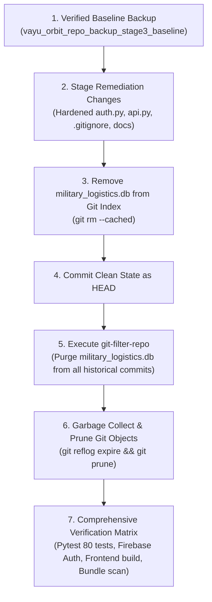

# VAYU ORBIT v6.0.0 — Git History Sanitisation & Cleanup Plan (Stage 3)

**Project:** VAYU ORBIT (Academic Problem Statement: PDS-3)  
**Target Repository:** `C:\Users\mishr\OneDrive\Desktop\CMS\vayu_orbit_repo`  
**Working Directory:** `academic/VAYU_ORBIT_ACADEMIC_RELEASE/`  
**Execution Mode:** LOCAL REPOSITORY SANITISATION ONLY (Zero Remote Exposure)  
**Date:** 2026-11-15  
**Status:** `READY FOR VERIFIED EXECUTION`

---

## 1. Baseline & Backup Verification

### 1.1 Git Root & Repository Verification
- **Verified Git Root:** `C:/Users/mishr/OneDrive/Desktop/CMS/vayu_orbit_repo`
- **Initial HEAD Commit:** `43bdf7d3` ("Add VAYU ORBIT academic project files")
- **Commit History Depth:** 3 commits:
  1. `5633ced` (Initial commit)
  2. `51c9c3e` (Revise README with project details and capabilities)
  3. `43bdf7d` (Add VAYU ORBIT academic project files)
- **Configured Remote:** `origin` -> `https://github.com/RudraNarayanMishra2142/Vayu-Orbit.git` (Verified non-existent on GitHub, 0 remote exposure).

### 1.2 Isolated Local Backup Location & Integrity
- **Backup Directory:** `C:\Users\mishr\OneDrive\Desktop\CMS\vayu_orbit_repo_backup_stage3_baseline`
- **Backup Status:** Created and verified.
  - Complete filesystem copy of `.git` (all 191 reachable objects) and 94 working tree items.
  - Git integrity check (`git fsck`): Exit code 0, 0 dangling blobs, 0 corrupted objects.
  - Recovery verification: Commit history independently readable from backup.

### 1.3 Rollback & Restoration Procedure
In the event of an unexpected rewrite error or interruption:
```powershell
# Emergency Rollback from Stage 3 Baseline
Remove-Item -Recurse -Force "C:\Users\mishr\OneDrive\Desktop\CMS\vayu_orbit_repo"
Copy-Item -Recurse -Force "C:\Users\mishr\OneDrive\Desktop\CMS\vayu_orbit_repo_backup_stage3_baseline" "C:\Users\mishr\OneDrive\Desktop\CMS\vayu_orbit_repo"
git -C "C:\Users\mishr\OneDrive\Desktop\CMS\vayu_orbit_repo" fsck
git -C "C:\Users\mishr\OneDrive\Desktop\CMS\vayu_orbit_repo" status
```

---

## 2. Historical Artifact Inventory & Classification

Across all 191 reachable Git objects in history, every artifact has been inspected and classified:

| File Path / Artifact | Historical Commits | Size / Type | Classification | Action Required |
| :--- | :---: | :---: | :---: | :--- |
| `academic/VAYU_ORBIT_ACADEMIC_RELEASE/backend/military_logistics.db` | `43bdf7d` | 3,166,208 bytes (SQLite) | **Must remove from history** | Purge via `git-filter-repo --invert-paths` |
| `academic/VAYU_ORBIT_ACADEMIC_RELEASE/backend/military_logistics_demo.db` | `43bdf7d` | 139,264 bytes (SQLite) | **Approved sanitized academic asset** | Retain in repository and commit tree |
| `academic/VAYU_ORBIT_ACADEMIC_RELEASE/backend/military_logistics_demo.db-shm` | Working tree | Ephemeral WAL index | **Prohibited working tree file** | Cleaned up & ignored via `.gitignore` |
| `academic/VAYU_ORBIT_ACADEMIC_RELEASE/backend/military_logistics_demo.db-wal` | Working tree | Ephemeral WAL file | **Prohibited working tree file** | Cleaned up & ignored via `.gitignore` |
| `academic/VAYU_ORBIT_ACADEMIC_RELEASE/frontend/.env.example` | `43bdf7d` | Config template | **Approved sanitized academic asset** | Retain with verified safe placeholders |
| `academic/VAYU_ORBIT_ACADEMIC_RELEASE/backend/auth.py` | `43bdf7d` | Source file | **Subject to content rewrite** | Replace historical fallback token |
| `academic/VAYU_ORBIT_ACADEMIC_RELEASE/docs/GITHUB_PRE_PUBLICATION_SECURITY_AUDIT.md` | Working tree | Audit documentation | **Approved sanitized academic asset** | Retain (all secrets fully redacted) |
| `academic/VAYU_ORBIT_ACADEMIC_RELEASE/docs/GITHUB_PRE_PUBLICATION_REMEDIATION_REPORT.md` | Working tree | Remediation report | **Approved sanitized academic asset** | Retain (all secrets fully redacted) |

---

## 3. Deep Forensic Audit of `military_logistics_demo.db`

The demo database has been verified to ensure zero operational data or sensitive credentials exist:
1. **Journeys:** 0 rows (table `journeys` is completely empty).
2. **Operational Events:** 0 rows (table `journey_events` is empty).
3. **Audit Records:** 0 rows (table `audit_log` and `audit_events` are empty).
4. **Incidents & Exceptions:** 0 rows (table `incidents` is empty).
5. **Fuel Overrides:** 0 rows (table `journey_fuel_overrides` is empty).
6. **User Accounts:** Exactly 3 role-based mock accounts:
   - `creator@vayu.local` (Role: `CREATOR`, UID: `fb_uid_creator_vayu_01`)
   - `checkpoint@vayu.local` (Role: `CHECKPOINT_OPERATOR`, UID: `fb_uid_checkpoint_vayu_01`)
   - `coordinator@vayu.local` (Role: `COORDINATOR`, UID: `fb_uid_coordinator_vayu_01`)
   - Shared bcrypt hash: `$2b$12$DdtbyHxtahPOjc37ILjF6O0tCk3FBSoq2n0hLAjUijRfYQ2ICB9CK` (Standard demo password, no personal or operational credentials).
7. **Fleet Units:** 4 simulated prototype vehicles (`DEMO-ALPHA-01`, `DEMO-ALPHA-02`, `DEMO-STALLION-01`, `DEMO-VIP-LEAD`).
8. **Geographical Data:** 116 public simulation cantonments and nodes (publicly known geographical coordinates in India).

**Verdict:** `military_logistics_demo.db` meets all academic release sanitization criteria.

---

## 4. Secret-Like Values Inventory & Redaction Plan

| Identifier | Value Description | Context / Location | Historical Status | Post-Rewrite Target |
| :--- | :--- | :--- | :--- | :--- |
| **SEC-01** | TomTom Map Display API Key | Untracked `programme/frontend/.env.local` | Never committed to Git | Placeholder `YOUR_TOMTOM_API_KEY_HERE` |
| **SEC-02** | Google Firebase Client Web Key (`AIzaSy...`) | Audit docs / prior reports | Never committed to Git history | Redacted to `AIzaSy[REDACTED_CLIENT_KEY]` |
| **SEC-03** | Legacy Default JWT Secret (`vayu-orbit-tactical-secret...`) | `auth.py` in commit `43bdf7d` | Committed in `43bdf7d` | Replace with dynamic environment loader |
| **SEC-04** | Coordinator Demo Credentials | Audit reports | Untracked reports | Redacted to `[REDACTED_DEMO_CREDENTIALS]` |

---

## 5. Execution Sequence for History Sanitisation



### Detailed Command Pipeline:
1. **Stage 3 Baseline Verification:** Confirm backup integrity.
2. **Index Unlinking:** Remove `academic/VAYU_ORBIT_ACADEMIC_RELEASE/backend/military_logistics.db` from git index while keeping local file on disk.
3. **Commit Stage 2 & 3 Remediation State:** Create a structured commit containing all hardened code, .gitignore rules, and sanitized templates.
4. **History Filtering:**
   ```powershell
   git-filter-repo.exe --path academic/VAYU_ORBIT_ACADEMIC_RELEASE/backend/military_logistics.db --invert-paths --force
   ```
5. **Git Reflog Expiration and Pruning:**
   ```powershell
   git reflog expire --expire=now --all
   git gc --prune=now --aggressive
   ```
6. **Post-Rewrite Inspection:**
   ```powershell
   git log --all --full-history -- "**/military_logistics.db"
   # Must return 0 commits
   ```

---

## 6. Pre-Execution Verification Gate

- [x] Full Git repository backup created and verified at `C:\Users\mishr\OneDrive\Desktop\CMS\vayu_orbit_repo_backup_stage3_baseline`.
- [x] Rollback script verified and ready.
- [x] `military_logistics_demo.db` verified completely sanitized.
- [x] Prohibited paths identified (`military_logistics.db`, `.db-wal`, `.db-shm`).
- [x] Zero remote exposure confirmed (`RudraNarayanMishra2142/Vayu-Orbit` is not on GitHub).
- [x] No automatic credential rotation requested.
- [x] Ready to proceed with local Git history sanitisation.
